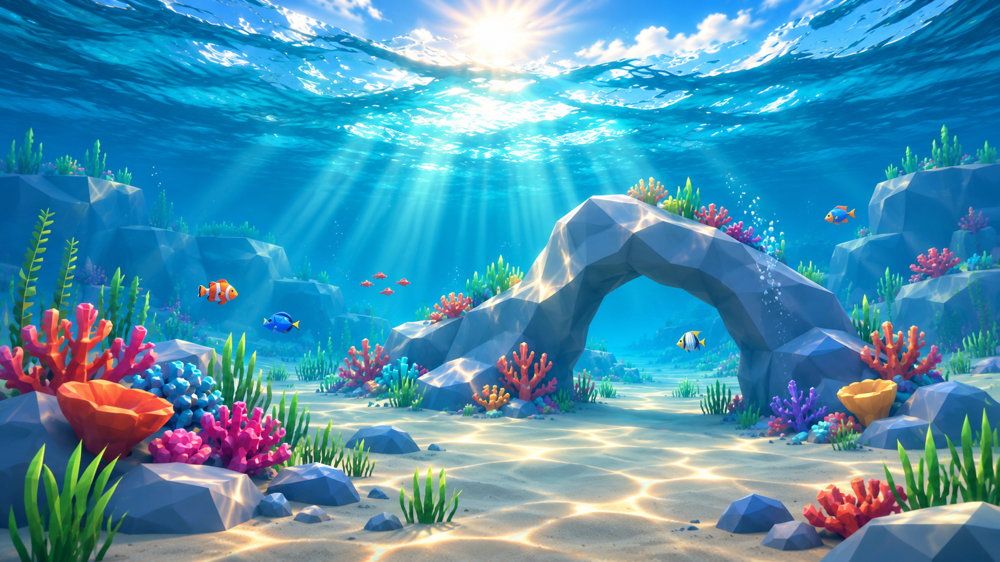

# Owner reference images

**Primary style target:** [reef-style-target.png](reef-style-target.png) (1672 × 941 PNG). The owner supplied this file from `/home/jfin/Pictures/target.png` and explicitly requested that it be saved in this repository on 2026-11-10. Its creator and license were not specified. Treat it as visual direction for Fish, not as geometry, textures or imagery to copy into the game.

The target shows the accepted **bright stylized low-poly reef naturalism**: faceted blue-gray rock and a swim-through arch, warm sand with caustic patterns, colorful coral and graphic plants, recognizable fish, clear blue water and strong sunlight. Use it to judge composition, silhouette, palette, density and underwater finish alongside the [art-style contract](../art-style.md). The target is a reference image; it does not prove that current Godot scenes or assets already achieve the look.

Earlier owner-supplied Reference A and B screenshots remain described in the [art-style contract](../art-style.md#owner-visual-references-2026-11-10); no files are separately registered for those descriptions in this checkout. Future checked-in references should include source/creator, permission, date and intended use. Do not copy reference objects literally.

The separate [Freshwater Pond reference pack](pond/README.md) preserves the owner's `best-pond-faf.png` anchor and five generated environment candidates for visual review. It is an aspirational later Pond target; it does not replace the reef/Ocean reference or establish implemented Godot behavior. The Pond record states the known source and license limits.
