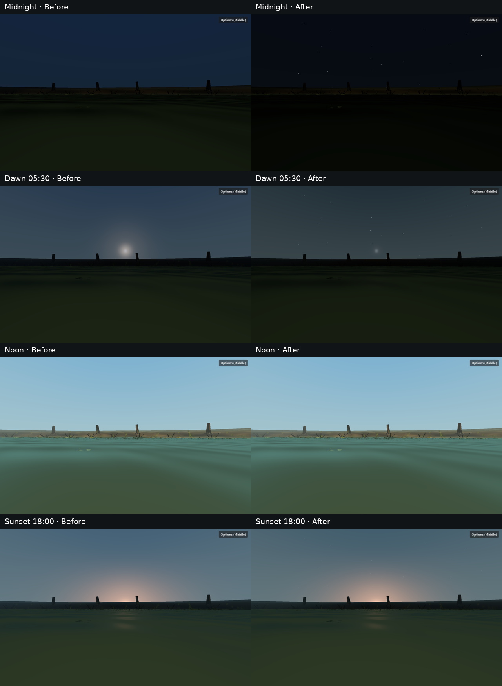

# Night optics repair candidate — 2026-11-12

## Result and review boundary

The native Forward+ candidate replaces the saturated navy midnight sky and luminous blue-green Pond fog with a very dark blue-black sky and dark olive water. The owner reviewed the water darkness and visibility during iteration and said it looked good, then requested that the underside match that darkness while moon and stars show through. The final candidate keeps the approved fog range and water palette and adds small, directionally aligned moon and star points to the dark underside. These points are shader transmission cues, not a second sky render or light source. Final owner review of the surface and motion remains open. This is not a c4/P4 Gate or version change.

| Review view | Matched comparison |
| --- | --- |
| Midnight sky and shore | [Before / after](comparison/sky-before-after.png) |
| Open underwater water | [Before / after](comparison/underwater-before-after.png) |
| Looking upward through the water | [Before / after](comparison/surface-before-after.png) · [final moon-facing underwater capture](candidate/moon_up_0000.png) · [moon-facing shore capture](candidate/moon_shore_0000.png) |
| Nearby fish and hollow log | [Fish crop](comparison/near-fish-crop.png) · [log crop](comparison/hollow-log-crop.png) · [full fish](comparison/fish-before-after.png) · [full log](comparison/log-before-after.png) |
| Normal nighttime swim | [Baseline route](baseline/manifest-motion.json) · [candidate route](candidate/manifest-motion.json) and `route_00.png`–`route_08.png` in each directory |

## Source and capture identity

- Base Git revision: `405116b7ff8aa9bb30cbebf9b86d9ee7322f893c` on `main`, with pre-existing uncommitted P4 and 0.5.0 work preserved. The night correction is uncommitted. The original baseline was captured before night edits; a second matched baseline capture rebuilt the original night source temporarily, then restored the candidate. The `baseline/` files are the original night rendering, not an earlier candidate.
- Tested project: Fish, Godot `4.7.2-stable (official)` .NET, native `forward_plus`, AMD Radeon 880M (RADV GFX1150), 1920×1200 fullscreen, Middle graphics preset, VSync disabled, FPS cap 0. Pond bake `pond-p4-71`, seed 71, world `world-5e3b4fee759acbe3`, content hash `d76eabbb5b6fff2f91418b49b2de92dd090541d609b46d0725ad9fc85cbda347`, Bluegill `FAF-FISH-006`.
- [Baseline](baseline/manifest-fixed.json) and [candidate](candidate/manifest-fixed.json) manifests record each hour, fish and camera transform, moon direction/visibility, sky and fog colors, ambient/direct energy, underwater sky/surface light, fog/volume density and range, plus per-view frame measurements. All ten original fixed poses match exactly on hour, fish/camera transforms, fog density, fog start/end/curve and volume density. Two final moon-facing views supplement the original matrix.
- Final tested source SHA-256: `SolarLightingState.cs` `c1f7862038b18028eb3ce9d26ce299a5202f6a0a174e3901e36dd6df7bbd642f`; `SolarWaterState.cs` `51b0b1567df3db58c7e705310497950c87849aa6aef1c5d3bd072ff0d6c03baf`; `WaterVisualProfile.cs` `f115ef62016c98d9d28b4df046dc1181b1dc7a3e0a2398a841f7d22b0798d454`; `UnderwaterAtmosphere.cs` `e2a95a32f25c1a9c78526b45b85f6935e368fb28ae2196ada0b388c8a4ee5282`; `underwater_sky.gdshader` `46e2d4b32143c244332f1ad36d27d3ad7483b145b5b907c15e5c7d422507fc9d`; `water_surface.gdshader` `822ee00bd093f8d8b40bd6ad82d404bef869cc27d4913973790a0eaf0a91e697`.

## Changes and observations

- Midnight Pond sky horizon/zenith are `(0.0025, 0.0040, 0.0065)` / `(0.0015, 0.0030, 0.0070)` in linear color. The moon is a narrow disc and halo in its actual direction. Dawn sun glow uses the actual sun direction, avoiding the former broad moon-position glow. A sparse, deterministic angular star field fades with night. Noon sky remains unchanged.
- Pond underwater night fog is `(0.025, 0.040, 0.022)` and night local/global volumetric scattering is olive charcoal. Pond night ambient is `(0.68, 0.70, 0.54)`, with a small moon direct-light contribution; close fish and logs remain recognizable. Ocean retains a cooler separate profile. Night fog density, near/far values, local sediment density and the baked world are untouched. Midnight fish/open-water fog density is `0.78`, near `4.5 m`; matched fish far `17.80 m`, log far `13.92 m`, open far `17.20 m` before and after.
- Pond night surface illumination is `0.030` instead of `0.120`; night underwater sky is `0.030` instead of `0.150`. The underside is brought to a small fraction of the night water fog tone and receives only the narrow moon disc/halo and sparse star points. No broad blue ceiling glow was added. At noon the shoreline comparison is pixel identical; underwater fish mean absolute RGB difference is `0.138/255` from renderer movement/noise. The sunset shore difference is `2.45/255`, with the existing warm sunset still present. [The contact sheet](comparison/contact-sheet.png) shows the transition.
- The first procedural star hash formed visibly paired points; the final hash removed that pattern. Underwater celestial cues fade with an upward view and distance along the surface, preserving the approved horizontal-water blocking. The moon-facing underwater capture shows the same dark underside around a restrained moon and dim stars. The moon is visible only when the view points toward its actual direction.

## Performance and checks

Frame times below are uncapped native elapsed frame measurements, so they include system scheduling noise; GPU-only timing was unavailable. The normal route used keyboard steering/forward input, the real fish motor and follow camera for eight seconds at midnight.

| View | Baseline median / p95 | Candidate median / p95 | Draws / primitives |
| --- | ---: | ---: | ---: |
| Midnight shore | 5.68 / 8.54 ms | 4.73 / 8.90 ms | 130 / 121,448 both |
| Midnight near fish | 5.38 / 7.18 ms | 4.03 / 6.76 ms | 206 / 129,978 both |
| Midnight hollow log | 4.63 / 6.65 ms | 4.16 / 6.38 ms | 210 / 130,664 both |
| Normal swim, 8 s | 5.27 / 9.85 ms | 5.08 / 8.25 ms | 202 / 182,240 both |

`tools/dev import` and `tools/dev build` passed with zero build warnings/errors. `inspect-environment-time`, `inspect-solar-lighting` (Pond and Ocean), `inspect-pond-surface`, and `inspect-pond-camera-immersion` passed. The native Pond continuous day sweep completed 432 frames through one midnight wrap with stable sun direction and sky/surface material identities; the three native pause cycles froze and resumed correctly. [Logs](diagnostics/) and the two candidate native probe logs contain no shader or runtime errors.

`inspect-pond-atmosphere` prints both `POND_TURBIDITY_CHECK_OK` and `POND_ATMOSPHERE_CHECK_OK`, including Pond→Ocean→Pond profile/preset isolation, but its wrapper returns failure: Godot emits `System.InvalidOperationException: Handle is not initialized` while `PondFafEnvironment` reloads catalog/material resources. This is a reload diagnostic error in the FAF resource path, outside the night shaders; the packet does not claim that check passed. See [the full log](diagnostics/inspect-pond-atmosphere.log). A native owner swim and visual review of the final moon/stars remain the qualification limit.
