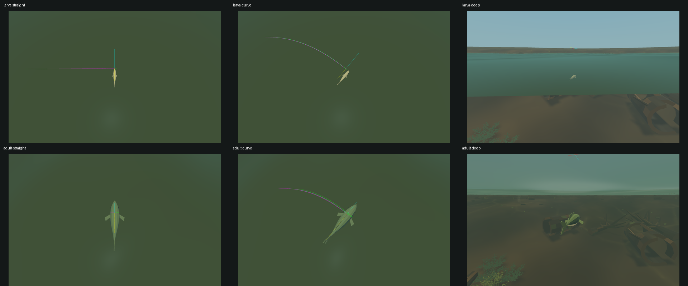

# W1 — body contact and world-space wake paths

**State:** implemented W1 candidate, ready for owner review; W2/W3 and V43/Gates remain open. 2026-11-15. Manual execution at `main` `c68451e92e9be47ee60868ebb6eee2b2ce58ecd1`. The tree was clean before W1 and is intentionally dirty with the W1 source, check, and evidence changes. Root package remains `0.5.12`; no commit or push.

## Implemented contract

- `PondWakeContacts.At` reads the attached `PlayerVisual` rest-pose mesh bounds measured by `PlayerBodyGeometry`. Fish forward is local `-Z`; the imported rig's facing and scale are included before measurement. Nose/shoulder/tail stations are fractions of the measured longitudinal length; the lateral pair is `0.62 ×` measured radius from the center. Contact uses the transformed shoulder height and a radius/top-reach allowance, then projects each anchor to its own local water height. These are stable body proxies, **not exact animated skin intersections**. Tail fin motion and dorsal fin extremes are not tracked.
- `FishController.PondSurfaceHeightAt(x,z)` is the wake's sole Y provider. It delegates to `UnderwaterAtmosphere.GetSurfaceHeight`, whose physics presentation clock drives the `water_surface.gdshader` vertex phase. `PondWaterline.Displacement` applies `ShoreBlend`; the shader uses the corresponding shore vertex colors. The rendered wave interpolates between physics ticks, so a tiny subframe diagnostic gap is possible. No new clock, fixed Y, or GPU readback was added.
- `PondWakePath` retains at most 48 samples for 2.2 active physics seconds. Each stores world center X/Z, historical heading, left/right source X/Z, birth time, body length/width, energy, stage revision, and segment. Real displacement and a 0.10 s upper interval control insertion; a 0.025 s lower interval limits bursts. Stillness, blocked movement, deep contact loss, and held boost alone add no sample. Deep resurfacing starts a new segment; teleports, stage reconfiguration, pause/focus, retry/suspend, and scene exit clear or release history.
- The development-only `--wake-path-debug` view draws current bow/shoulder/tail contacts, a local heading, centerline, two outward projected historical paths, and age fade. The line display is lifted 0.06 m so transparent water does not hide it; stored anchors and sampling retain the true local surface Y. It is absent by default and compiled into Debug builds only. The eight production `SurfaceRing` nodes and all underwater particles remain in place.

## T2 checks

| Check | Result |
| --- | --- |
| `./tools/dev import`, `./tools/dev build` | PASS; Godot 4.7.2 .NET import and C# build, zero warnings/errors. |
| `./tools/dev inspect-wake-path` | PASS; 14 samples from an actual juvenile Bass motor route at the Pond interface, including a turn, remained at past world positions. Actual imported Bass larva, juvenile, subadult, adult rest-pose bounds and anchor surface Y; yaw/pitch, camera independence, 30/60/120 FPS sample density, acceleration/turn/reverse, still/deep/blocked, segment break, teleport, pause, growth/retry clear, 48-slot wrap, 2.2 s lifetime, wave crest/trough and dry shore. Measured lengths: 0.0791, 0.3204, 0.6751, 1.0000 m. |
| `./tools/dev inspect-dynamic-waterline` | PASS; matched shader/CPU vertex displacement, shoreline and moving surface following. |
| `./tools/dev inspect-pond-surface` | PASS; normal Pond ascent and existing surface contract. |
| `./tools/dev inspect-growth` | PASS; Pike Encounter growth/rig integration through adult. |
| `./tools/dev inspect-hatch` | PASS after fixing an existing test assertion that compared the fry camera against fixed base water Y. Two initial runs failed by 0.0004 m at that threshold while the camera was 0.0683 m above the actual local wave; the corrected check uses `fish.PondSurfaceHeightAt(eye.X, eye.Z)`. No camera or motor logic changed. |
| `./tools/dev inspect-auto-feed-boost`, `./tools/dev inspect-pond-camera-immersion` | PASS; recent finite boost and camera/waterline behavior remain intact. |
| `./tools/dev inspect-wake-native` | PASS for six Forward+ diagnostic captures; Godot 4.7.2, Vulkan 1.4.318, AMD Radeon 880M, Pike Encounter seed 5266. |

The native probe stages actual imported larva/adult visuals at the shared waterline, feeds controlled straight/curved positions into the same history class, and captures deep poses with zero samples. Purple/green are the two side paths, cyan is center/heading, yellow is the body station line, and red marks lost contact. The six full-resolution frames and log live under ignored `artifacts/wake-path/native/` and `artifacts/logs/wake-native.log`; this sheet is the durable review image. The first capture required disconnecting the fixture camera's viewport-resize snap in the probe, after which all six framing checks were inspected.

## Limits for review

- Native path images are **staged diagnostic routes**, not footage of the actual motor route or owner free-swim judgment. The headless integration check exercised an actual moving juvenile fish. Fry and adult are pictured; juvenile/subadult were checked against their real mesh bounds in the headless scene.
- Contact stations are rest-pose proxies. Animated fins, tail beat, steep pitch at the waterline, and exact skin intersection need owner visual judgment during W2/W3. The side proxy includes a conservative fin/radius envelope.
- No production wake material, performance cost comparison, normal/boost visual tune, or W2 replacement is claimed. Existing rings remain visible in normal play. No Roadmap Gate is marked GREEN.
