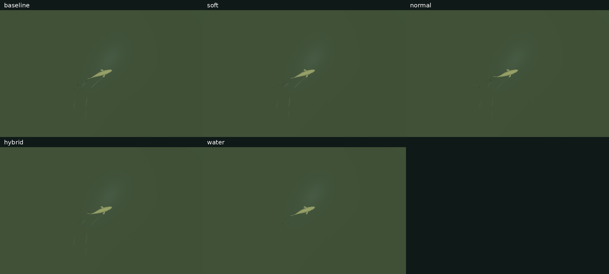
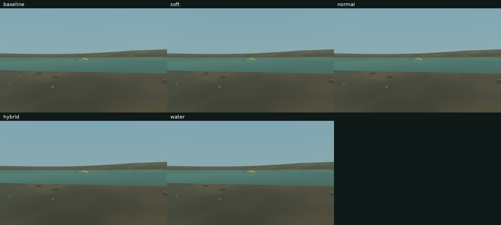
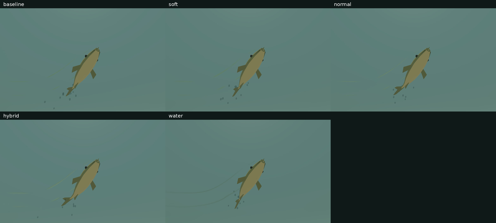
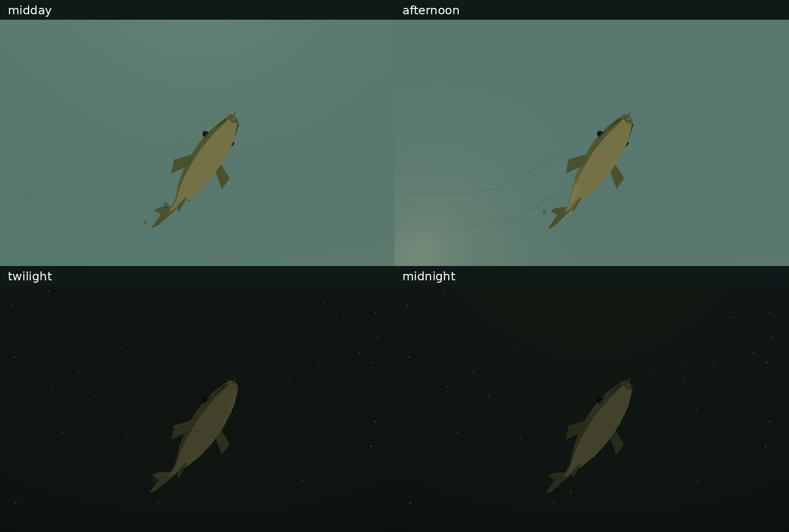
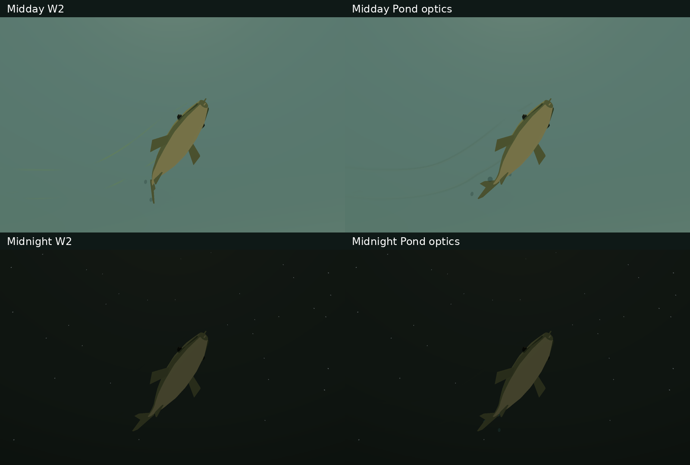

# W2-R1 — surface wake visibility repair trial

**State: NOT GREEN.** The waterline readability requirement is still unmet. W3 has not started. This is a separate 2026-11-15 recovery record; [W1](w1.md) and [W2](w2.md) evidence remains unchanged. The production default remains W2. No package version, Gate, commit, or push change.

## Source and native fixture

- Preflight: `main` at `21dc960d31ecbb315413c633a86f272af43b8c9b`, clean working tree, `origin` at `github.com/jfin602/fish`; root version `0.5.12`. The W2 note about uncommitted work describes its earlier execution, not this preflight.
- Trial source: same HEAD with local changes to `PondWakeRenderNativeProbe.cs`, `PondWakeRibbon.cs`, `WaterReaction.cs`, `UnderwaterAtmosphere.cs`, `pond_wake.gdshader`, and `water_surface.gdshader`. SHA-256 of `git diff --` those six files: `691b43e3efa6b95b9bd8c320a0fc442527e123d42ea4f9d76e65ec4f312ef95c`. The five comparison PNG sheets and this record are additional uncommitted files. Candidate selection flags are Debug-only; no candidate is promoted to the normal W2 presentation.
- Godot 4.7.2 .NET, Forward+ / Vulkan 1.4.318, AMD Radeon 880M (RADV GFX1150), actual `res://scenes/p5_pike_encounter.tscn`, baked Pond `world-6c98f9e946b4ede8`, seed 5266, imported juvenile Bass. No `--graphics=low` flag; scene/default graphics settings and wave settings were held fixed. Time was frozen at solar hour 12 for the five-way comparison. The Fish editor was running, but this session's Godot MCP server could not bind its already occupied Fish bridge port, so captures used the same project and native Godot executable directly, not MCP editor commands.
- The Debug replay uses real fish input and motor at 60 Hz: W, then W+D curve, W+Space genuine boost, coast, W+Down dive, and rest. At tick 95 all five views share fish `(0.2552562, 10.340215, -30.605066)`, speed `0.864`, boost active, 20 history samples, 664 triangles, surface Y `10.3610`, wave clock `1.6500`, and true contact. An exact log comparison passed for **all 16 captures in each of five modes**, including tick, camera transform, position, speed, boost, samples, triangle count, local surface, and solar hour. PNG writes are excluded from frame timing. Full-resolution images and logs are in ignored `artifacts/w2-r1/native/` and `artifacts/logs/w2-r1-*.log`.

| Tick 95 view | Camera world position | Camera direction / basis |
| --- | --- | --- |
| Above, top | `(0.25525665, 12.011003, -30.575066)` | Forward basis Z `(0.00000027, 0.9998348, 0.0181775)` |
| Oblique above | `(1.3052559, 11.111003, -29.205067)` | Basis Z `(0.5514870, 0.3939194, 0.7353159)` |
| Just above line | `(1.6052561, 10.416003, -30.425068)` | Basis Z `(0.9897285, 0.0549855, 0.1319627)` |
| Intersecting line | `(1.6052561, 10.361003, -30.425068)` | Basis Z `(0.9911212, 0.0146836, 0.1321483)` |
| Under, upward | `(0.6052561, 10.011003, -30.565067)` | Basis Z `(0.6474816, -0.7584801, 0.0739961)` |
| Under, diagonal | `(1.5052567, 10.121003, -30.355068)` | Basis Z `(0.9662963, -0.1700676, 0.1932577)` |

## Diagnosis and candidates

The original W2 front is **present**, with matched world coordinates and correct local wave Y, but its late-stage half-width is very small for a juvenile and projects to a thin trace at shallow angles. The underwater color sits close to the Pond's green scattering. Its unshaded `pond_wake` shader uses an alpha/color overlay, a synthetic reflection term, disabled fog, and a 0.032 m lift; it does not perturb the actual Pond surface's reflection. The five-view capture separates this contrast problem from missing geometry. No Z-fighting or path rotation was observed. The intersecting-line view also compresses the horizontal front into a few pixels, so material contrast alone has limited effect.

| Mode | Change | Native visual judgment |
| --- | --- | --- |
| Baseline W2 | Original width/material, current matched route | Soft white from above; underwater and waterline nearly lost. |
| A, `soft` | 1.85× footprint, softer grain, reduced alpha per area | Slightly wider underwater trace; remains faint at waterline. No solid stripe. **Rejected** for insufficient repair. |
| B, `normal` | Same geometry, signed slope response from view and solar direction | More visible underwater but olive/light painted line, especially looking up. **Rejected** for realism. |
| C, `hybrid` | A width plus B response | More visible line, still painted; no distinct waterline gain. **Rejected**. |
| Additional `water` trial | Same bounded ribbon/history at 1.85× width, rendered with the Pond surface optics and a small local normal slope; copied live surface lighting parameters | Most waterlike dark/light underwater response and no nighttime glow. Still too dark from above and nearly invisible at the waterline. **Best provisional experiment, not selected for production.** |

These sheets contain full-frame, unenhanced native captures scaled equally for review. Their top-left to bottom-right order is baseline, A, B, C, water. The full-resolution frames reveal the soft differences more reliably than the sheets. The curve/boost consecutive frames in the native folder show motion continuity; these are controlled motor captures, not owner free-swim footage.

## Lighting, breach and cost

The `water` trial was captured on the same route at 12:00, 16:30, 19:00 and 00:00 with the debug clock frozen. Midday and late afternoon retain a dark, low-contrast underside trace; twilight and midnight extinguish it with the Pond, with no wake glow observed. W2 baseline was also captured at matched midday and midnight. The day/night system and general illumination were not changed.

Two native ascent attempts placed the fish below the real waterline and held real W+Up input. From 0.15 m below the center limit, vertical speed reached `0.191 m/s` at tick 40 but body top remained `0.080 m` below the local surface; from 0.075 m below the limit, body top reached `0.040 m` below by tick 55 but vertical speed had tapered to `0.014 m/s`. Both recorded `contact=False`, zero wake samples, and `splash_emitting=False` at the captured ticks. **Genuine breach/splash: NOT OBSERVED.** This suggests the existing ascent taper and contact/splash thresholds do not overlap on these routes; it does not prove that all legitimate breaches are impossible. No synthetic splash assertion, motor change or new splash system was made.

Final-source, full-route representative Forward+ measurements, 351 sampled frames per mode, with the separate owner play window closed, VSync-limited and excluding PNG I/O:

| Mode | Median / p95 ms | Draws median / p95 | Primitives median / p95 |
| --- | ---: | ---: | ---: |
| Baseline W2 | 16.661 / 20.115 | 144 / 180 | 617,204 / 638,106 |
| A soft | 16.638 / 18.247 | 144 / 180 | 617,236 / 638,106 |
| B normal | 16.661 / 19.208 | 144 / 180 | 617,204 / 638,106 |
| C hybrid | 16.658 / 19.434 | 144 / 180 | 617,204 / 638,106 |
| Pond optics trial | 16.662 / 20.117 | 144 / 180 | 617,204 / 638,106 |

The median difference between baseline and Pond optics is `+0.001 ms`, and p95 is `+0.002 ms` in the final controlled pair. No meaningful regression is visible in these frame/draw/primitive measurements, although VSync and run-to-run p95 variation limit attribution. No usable GPU timing was exposed. The 48-sample, 2.2-second, 1,624-triangle caps remain unchanged; the representative route peaked at 1,192 triangles. The optical candidate adds shading only to bounded ribbon pixels, with no water-wide history loop, render target, reflection camera, or scene remesh.

## Focused checks and boundary

- **PASS:** `./tools/dev import` and `./tools/dev build`, zero build warnings/errors; final native shaders compiled without reported errors. The first experimental shader run failed to compile due to a reserved identifier, was corrected, and its images/timings were discarded.
- **PASS:** `inspect-wake-ribbon` (888 synthetic triangles, vertex-local Y, dry shore, clear), `inspect-wake-path` (all four stage bounds, historical turns, fixed caps, pause/growth/retry), `inspect-dynamic-waterline`, `inspect-pond-surface`, normal Pond scene, `smoke-world` and `inspect-water` for Ocean/isolation and pause/focus cleanup.
- **PASS:** In matched native `water` trial, `--effects=off` had zero samples/triangles; `--effects=low` kept 20 samples/664 triangles at reduced material strength. The ordinary Pond and Pike Encounter use the same `WaterReaction` class. No movement, collision, boost-energy, growth, prey or AI source was edited.
- **FAIL:** Perceptible normal-speed underwater wake from all requested camera angles, and especially waterline readability without a painted line. The selected provisional candidate does not meet W2-R1 criteria 1–4. Owner native playfeel is unobserved. The final game handoff can show the debug `water` trial, but it must not be treated as qualification.

**Owner handoff:** the actual Fish Pike Encounter is running in Forward+ with `--wake-repair=water` for a provisional visual playthrough. The normal scene began at egg, completed hatch into Bass larva, and logged `PIKE_ENCOUNTER_READY`; this is a live owner review, not a claim that the five-view failures passed.

**Next action:** investigate a small *actual water-surface* normal influence or very shallow local crest geometry that survives grazing views, then repeat the same five-view route and cost checks. Keep W2 as the production default until a candidate passes the waterline and realism criteria. Do not start W3 or mark V43/Gates GREEN.
