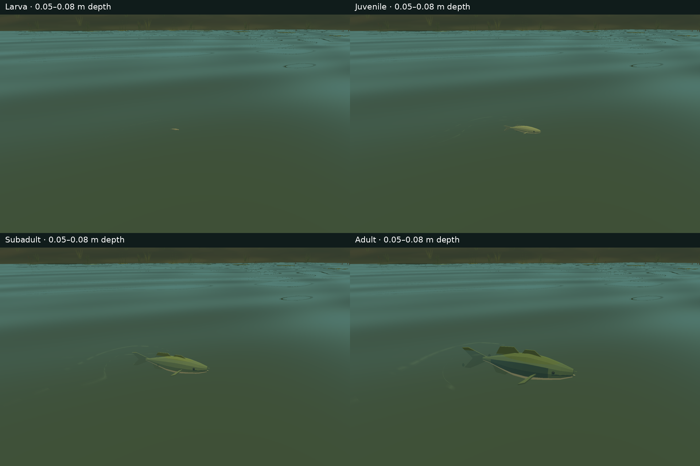
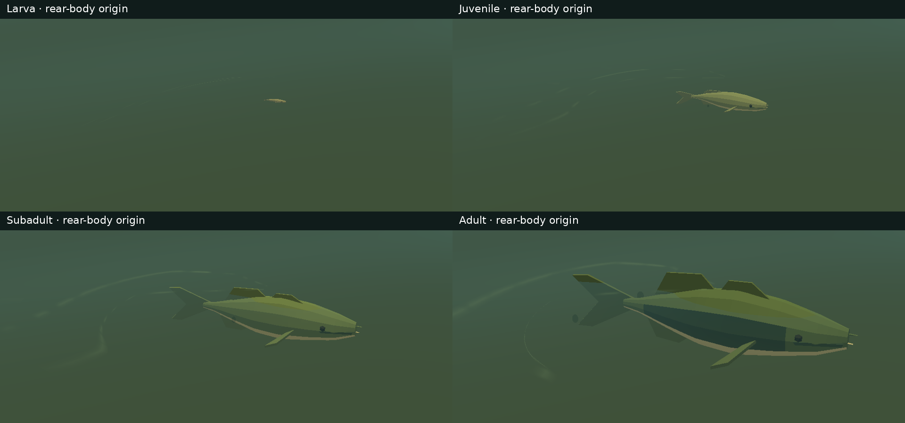
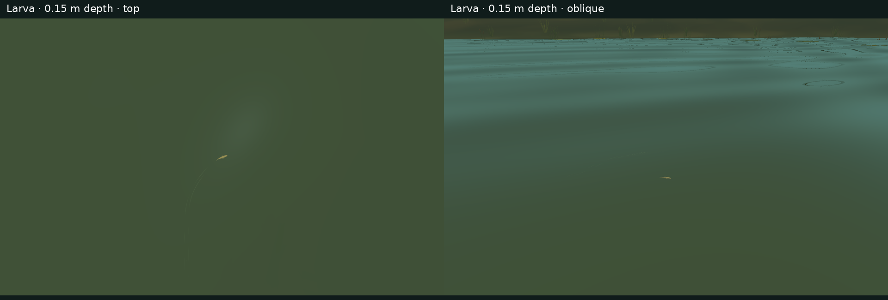

# W2-R2 — owner-selected hybrid, stage attachment and shallow-dip continuity

**State: implemented candidate, owner native playfeel open.** The owner selected the hybrid option from [W2-R1](w2-r1.md) and supplied a Pike Encounter larva screenshot showing apparent separation between the fish and surface lines. This record adds no W3 or Roadmap Gate claim. The previous W2-R1 judgments remain historical; its candidate table was not rewritten.

## Change and source

- `main` remains at `21dc960d31ecbb315413c633a86f272af43b8c9b`, with uncommitted W2-R1 and W2-R2 changes. No version bump, commit, or push. The SHA-256 of the W2-R2 affected C# source diff (`PlayerBodyGeometry`, `PondWakePath`, `PondWakeRibbon`, `WaterReaction`, and the three wake checks/probe) is `e2c631efc03b837917550c4db51c7abf346e06ba64c34e68f3176ece6aaf93c2`.
- Hybrid (1.85× feathered ribbon footprint plus the normal-aware Pond wake response) is the default in both Debug and Release. The Debug `--wake-repair=baseline` switch remains for comparison. No motor or camera source was changed.
- The wake side stations now use the visible mesh's measured side extent for each Bass stage. Following owner feedback that the line began too far forward, its lead begins at 48% of nose-to-tail length and its two side stations at 68%, toward the tail. A short final ribbon segment bridges the newest historical sample to those live rear flanks. Its segment, age, and displacement guards prevent joining an older or distant trail. The fixed triangle cap is 1,640 (previously 1,624).
- Following the owner's depth correction, wake entry extends to a fish origin **0.20 m below the local moving surface at the fish center**, independent of stage size. Once active, a 0.05 m release margin prevents boundary flicker; beyond 0.25 m new samples stop and old fronts decay in world space. The exposed-fish cutoff and motion/energy gates remain.

## Checks and native observation

**PASS:** Godot 4.7.2 .NET import/build (zero warnings/errors), `inspect-wake-path`, `inspect-wake-ribbon`, `inspect-dynamic-waterline`, `inspect-pond-surface`, `inspect-water`, and `smoke-world`. The path check measures all four actual Bass meshes, verifies flank stations at 68% of body length, eligible entry at 0.20 m and ineligible entry at 0.22 m, a 0.25 m release threshold, and depth variation between 0.08 and 0.19 m without splitting the path. The ribbon check verifies the live rear-flank bridge adds exactly 32 triangles (16 for the short lead and 16 for the final trail pair) and stays under cap. Existing pause, growth reset, historical heading, local wave Y, shore and deep-water checks passed.

**PASS, controlled native replay:** Forward+ / Vulkan 1.4.318 on AMD Radeon 880M, baked Pond `world-6c98f9e946b4ede8`, seed 5266, solar hour 12. The real fish motor received the same W, W+D, W+Space route through tick 95. Each run replaced the fixture's Bass visual and body with one actual registered stage before input, then captured top, oblique, and underwater views with the same camera offsets. This is a controlled art/body-stage replay, not a complete feeding/growth lifecycle. Full-resolution PNGs and logs are in ignored `artifacts/w2-r2/native/` and `artifacts/logs/w2-r2-*.log`.

| Stage | Measured body length / side reach | Depth at capture | Path samples / triangles | Frame median / p95, 86 frames |
| --- | ---: | ---: | ---: | ---: |
| Larva | 0.0791 / 0.0093 m | 0.0495 m | 43 / 1,464 | 16.639 / 17.270 ms |
| Juvenile | 0.3204 / 0.0526 m | 0.0502 m | 22 / 752 | 16.612 / 17.384 ms |
| Subadult | 0.6751 / 0.1280 m | 0.0685 m | 14 / 480 | 16.684 / 17.390 ms |
| Adult | 1.0000 / 0.1992 m | 0.0812 m | 12 / 408 | 16.606 / 17.608 ms |
| Larva shallow dip | 0.0791 / 0.0093 m | **0.1495 m** | 43 / 1,464 | captured; same motor route |
| Larva deeper | 0.0791 / 0.0093 m | **0.2695 m** | 0 / 0 | captured; same motor route |

The top view places the path behind the fish's projected mid/rear body. The close-up sheet crops the native frames equally to show attachment; the full-frame sheet retains context. From an oblique view the wake lies on moving water while a submerged fish lies below it, so some vertical/parallax separation remains even when X/Z anchors agree. The near-body hybrid trace remains delicate, especially for larva. **Owner free-swim alignment and waterline readability are NOT OBSERVED as green.** No claim is made that the complete W3 visual matrix or previous W2-R1 waterline concern is closed.

## Next action

Play the ordinary Pike Encounter with the selected default through shallow dips, turning and growth. Judge whether the rear-body origin and 0.20 m entry depth read naturally from the owner's follow camera. W3 and Gate status remain open.
