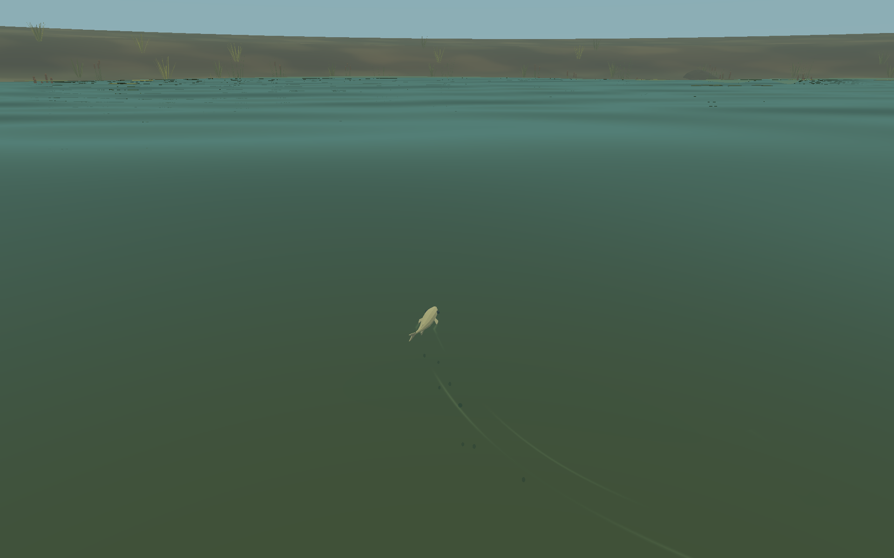
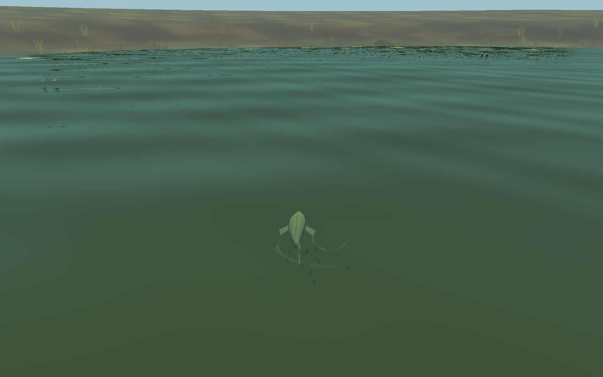
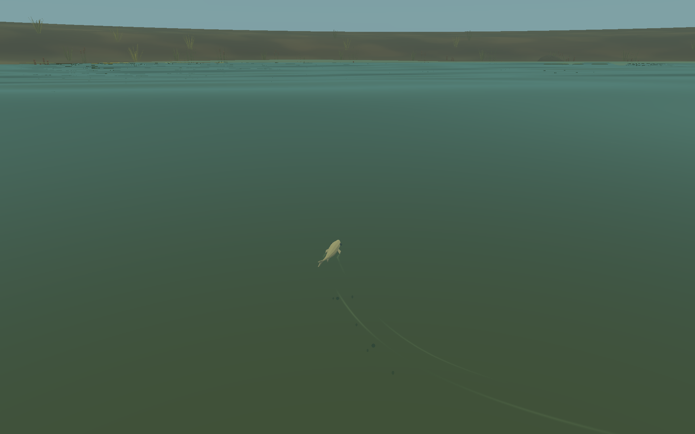

# W2-R3 — fin-origin wake in the normal follow camera

**State: implemented visual trial; owner free-swim review and W3 remain open.** The owner observed that the W2-R2 lines looked correct in controlled pictures but appeared as flat marks on top of the water from the real game camera. The requested trial starts each line at the back rim of the fish's pectoral fin instead.

## Source and behavior

- The working tree began at `21dc960d31ecbb315413c633a86f272af43b8c9b` with earlier wake edits. During this run, another workspace operation advanced `main` and `origin/main` to `82794a817e96ba86d7b80c8f879a2689f16ac9a6`, which includes this C# implementation and other concurrent work. This task made no commit or push. The R3 evidence and routing edits were still local when recorded.
- `PlayerBodyGeometry` measures the rear rim of the separate left and right pectoral meshes in each actual Bass stage. The contact positions follow the fish pose and the visible model's root motion. A non-Bass visual without separate pectoral meshes uses the prior rear-flank fallback.
- New wake samples retain each fin's world height. A short join leaves each fin toward the rear at that height; the historical paired fronts follow the traveled path and slowly rise toward the local moving surface. The older flat mid-body-to-surface lead was removed. The selected hybrid material and bounded 1,640-triangle mesh budget remain.
- Entry stays at 0.20 m below the local surface, with the existing 0.25 m release threshold. A deep fish starts no new wake. Stage changes, pause and retry still clear the path.
- The attachment is based on each fin mesh's measured rest-pose rim and current whole-visual transform. It does **not** yet apply individual pectoral bone deformation; the owner should watch for small attachment wobble during strong fin flaps.

## Native evidence

**PASS, controlled follow-camera replay:** Godot 4.7.2 .NET, Forward+ / Vulkan 1.4.318, AMD Radeon 880M, baked Pond `world-6c98f9e946b4ede8` seed 5266, solar hour 12. The fixture replayed W, W+D and W+Space through the live fish motor while the ordinary `FollowCamera` ran. It swapped in the actual registered Bass art and body for each stage. The fixture hides the HUD and freezes unrelated ecology, so this is a follow-camera visual test, not a full gameplay playthrough. Full native logs and PNGs are in ignored `artifacts/w2-r3/`.

| Stage | Fin spacing / body length | Boost capture depth | Samples / triangles | Frame median / p95, 86 frames |
| --- | ---: | ---: | ---: | ---: |
| Larva | 0.0174 / 0.0791 m | 0.0494 m | 43 / 1,464 | 17.625 / 32.308 ms |
| Juvenile | 0.0958 / 0.3204 m | 0.0497 m | 22 / 752 | 17.107 / 24.806 ms |
| Subadult | 0.2317 / 0.6751 m | 0.0674 m | 13 / 448 | 17.488 / 24.130 ms |
| Adult | 0.3602 / 1.0000 m | 0.0796 m | 12 / 408 | 19.123 / 25.006 ms |

At larva cruise, the first projected contact moved from about 105 viewport pixels above the fin in the preliminary surface-join trial to about 6 pixels behind it at fin depth. The normal-camera captures no longer show that upward join. The larva boost path starts behind the side fins; the juvenile and adult captures show the same attachment pattern at their own body scales. Frame timings include unrelated native scene work and are observation only, not a matched performance qualification.

**Depth replay:** A larva starting 0.18 m below the surface remained eligible through cruise and boost (43 samples, 1,464 triangles at the boost capture). At a 0.27 m start depth, the same route made zero samples and zero triangles; the moving wave placed it at 0.2394–0.2589 m depth during the captures, still outside the 0.20 m entry band. This does not replace the separate hysteresis check for an already active wake.

**PASS, source and scene checks:** `./tools/dev build` (zero warnings/errors), `inspect-wake-path` (four fin geometries, 0.20 m entry, 0.25 m release, shallow continuity), `inspect-wake-ribbon` (bounded mesh and fin-depth vertices), `inspect-water`, and `inspect-dynamic-waterline` (moving-water and deep-water regression). `git diff --check` passed. The first dynamic-waterline run exposed an obsolete assertion that all wake vertices sit on the surface; its check now verifies that fin-depth vertices stay in the fin-to-surface range, and the rerun passed.

## Remaining qualification

The owner should play the ordinary Pike Encounter from the normal camera, including larva, growth, turns and shallow dips, to judge the line strength and fin-flap attachment in motion. W3, native free-swim playfeel, and Roadmap Gate status remain open.
