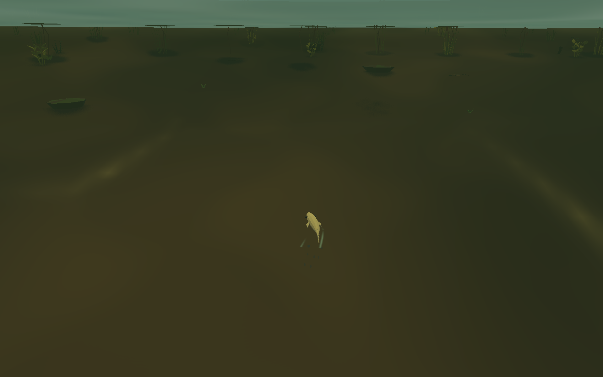
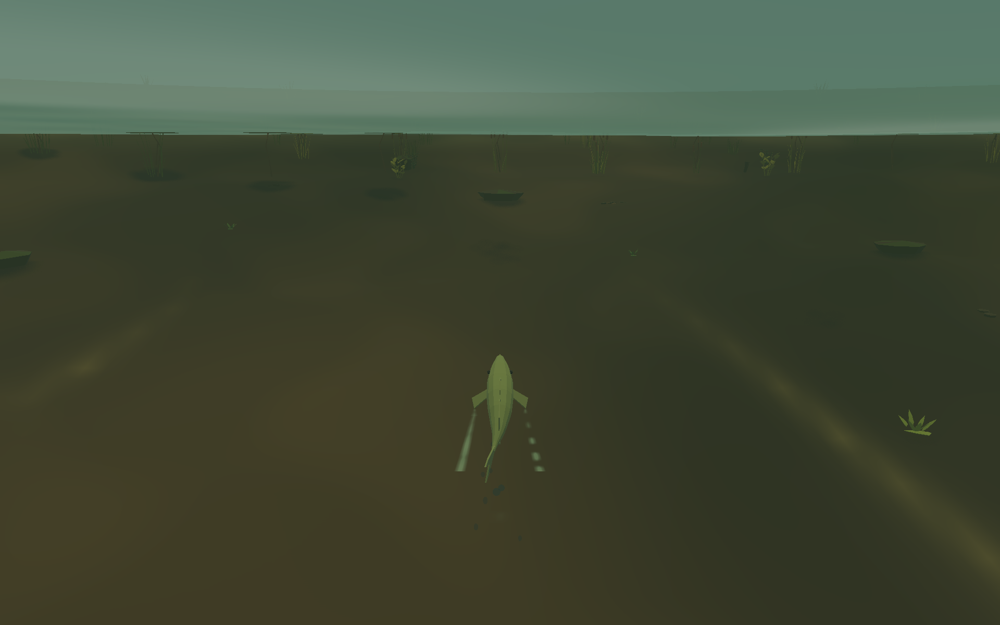
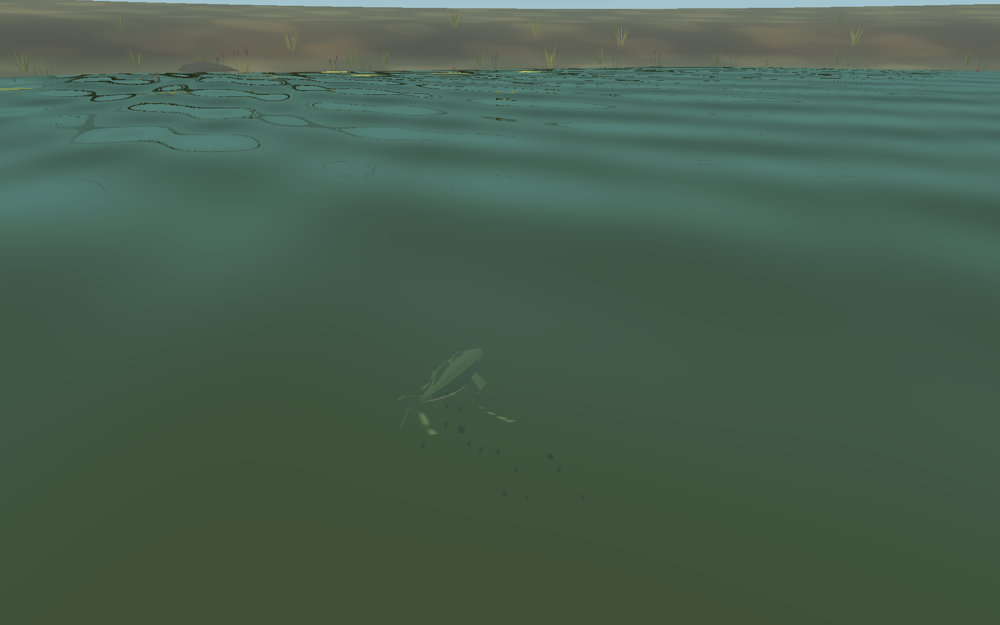

# W2-R4 — fin-origin trails on sharp underwater turns

**State: implemented visual trial; owner free-swim playfeel and W3 remain open.** After approving the fin-origin look, the owner asked for the same effect during sharp underwater left/right and up/down turns, continuing until the fish straightens.

## Behavior

- The Pond presentation reads accepted yaw and pitch change from the fish motor. A moving fish more than 0.20 m below the local surface starts the paired ribbon at 42°/s of combined turn rate. It continues while the rate is at least 22°/s. The lower release rate prevents flicker as steering eases. Movement below 18% of the stage's maximum speed does not create a trail.
- Both sides start at the actual Bass pectoral-fin rims. Underwater samples retain their world height and follow the 3D turn; they do not rise onto the water plane. The shader uses the Pond's submerged tint even if the camera is above the fish. Surface and underwater histories form separate segments, so a depth crossing cannot draw a line between them.
- Straight swimming makes no new underwater ribbon. The existing turn history fades in world space over the same 2.2-second lifetime. The previous surface wake, its 0.20 m entry / 0.25 m release band, bubbles, pause cleanup, and Ocean isolation remain.
- This is rendering only. It does not write fish velocity, collision, input, camera, game time or sensing.

## Native follow-camera evidence

Godot 4.7.2 .NET, Forward+ / Vulkan 1.4.318 on AMD Radeon 880M; baked Pike Encounter Pond `world-6c98f9e946b4ede8`, seed 5266, noon. The replay drove the live motor with W and then a held directional key from tick 35 to 70. The ordinary `FollowCamera` ran. Each stage used its registered body art, collision shape and movement tuning. The fixture hid the HUD and froze unrelated ecology; this is not a full player-controlled playthrough.

| Stage / turn | Before turn, tick 25 | During turn, tick 55 | After release, tick 95 |
| --- | ---: | ---: | ---: |
| Larva / left | inactive, 0 samples | active, 5 samples / 168 triangles | inactive, old history fading |
| Juvenile / down | inactive, 0 samples | active, 4 / 136 | inactive, old history fading |
| Subadult / up | inactive, 0 samples | active, 6 / 208 | inactive, old history fading |
| Adult / right | inactive, 0 samples | active, 5 / 168 | inactive, old history fading |

The separate larva fixture also passed all four turn signs: left and right yaw, up and down pitch. In every turn capture the fish was outside the surface band and the latest history was marked underwater. The adult rerun additionally checked that no new sample had been born in the last 0.16 seconds of the straightened capture. The largest turn capture in the stage-tuned matrix used 208 triangles, below the existing 1,640-triangle budget. The adult median / p95 native frame times were 16.562 / 25.010 ms over 86 frames; these include unrelated scene work and are not a matched performance comparison.

**PASS, focused checks:** `./tools/dev build` (zero warnings/errors), `inspect-wake-ribbon` (fin-depth vertices, submerged shader marker, mode-segment boundary, turn threshold), `inspect-wake-path` (four stage anchors and surface hysteresis), `inspect-water` (Ocean and cleanup), and a 0.18 m follow-camera surface-wake regression capture (43 samples, 1,464 triangles at boost). `git diff --check` passed.

## Limit

The captures show a controlled route from the normal camera. The owner should still judge trail strength and duration during continuous free swimming and growth. W3 and Roadmap Gate status remain open.
