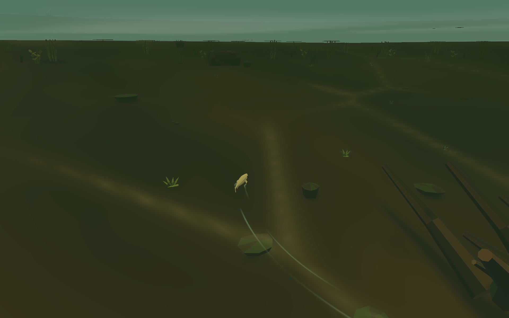

# W2-R5 — underwater boost trail

**State: implemented visual trial; owner free-swim playfeel and W3 remain open.** The owner asked for the fin-origin underwater trail to appear during boost as well as sharp turns.

`WaterReaction` now treats the fish motor's **active** boost state as a second trigger while the fish is deeper than the 0.2 m surface band. It does not react to a held Space key when boost is blocked or exhausted. A boost can start the trail at low speed; the existing path sampler still requires displacement to grow it. The trail continues while boost is active and fades after boost ends, unless a sharp turn remains active. Near the surface, the existing surface wake takes precedence. No movement or sensing state is changed.

**PASS:** `./tools/dev build` (zero warnings/errors) and `inspect-wake-ribbon` (boost-only gate, release, surface exclusion and fin-depth geometry). A Forward+ native Pike Encounter replay at roughly 0.77 m depth showed active boost at tick 95, yaw input down to 0.132 of the stage rate (below the 22°/s turn continuation threshold), and an active underwater ribbon with 25 history samples / 848 triangles. It used the ordinary follow camera on Godot 4.7.2 .NET and AMD Radeon 880M. The fixture hides the HUD and freezes unrelated ecology.

