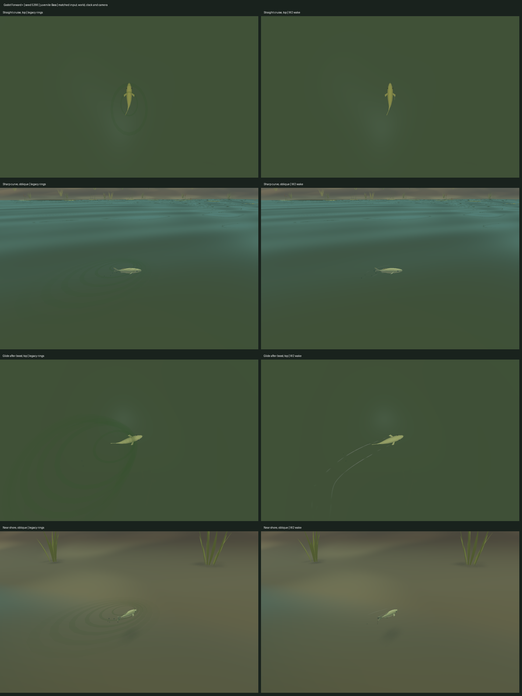
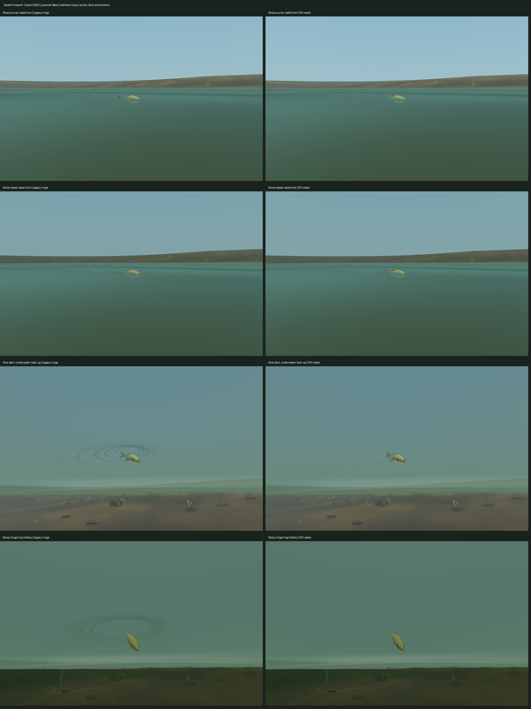

# W2 — natural Pond wake rendering

**State:** implemented visual candidate, **not GREEN**. Owner visual review is required before W3. Manual work on `main` at `c68451e92e9be47ee60868ebb6eee2b2ce58ecd1`, 2026-11-15. The tree is intentionally dirty with W1 and W2; root package stays `0.5.12`. No commit, push, version change, or Roadmap Gate pass.

## What runs

`WaterReaction` now draws the Pond surface disturbance through one `PondWakeFronts` `ImmediateMesh` and one small breach-only `SurfaceSplash` emitter. The production `SurfaceRing` pool is gone; the original ring code is available only in Debug with `--wake-legacy-rings` for the fixed-route comparison. The three existing submerged tail particle emitters are unchanged, and the same shared `WaterReaction` is used by ordinary Pond and Pike Encounter. Ocean's existing presentation is unchanged.

`PondWakeRibbon` consumes W1's 48-slot, 2.2-second world-space history. Left/right fronts advance from historical shoulder positions along each sample's historical outward direction. Two bounded spline steps between samples soften turns; station width and strength taper with age, with irregular breakup, a short bow line and sparse tail eddies. One mesh holds at most **1,624 triangles**; the native juvenile route peaked at **1,192**. The material uses feathered alpha, weak pseudo-normal/specular contrast and the Pond daylight palette. Camera above the local front sees soft **white** crests; camera below sees the existing **green** Pond palette. Underwater alpha is raised to survive the Pond's scattering; it still tapers with age and distance. `RenderPriority = 1` orders the transparent fronts after the transparent water surface.

Every emitted vertex calls `UnderwaterAtmosphere.GetRenderedSurfaceHeight(x,z)`, which samples the same `SampleSurfaceHeight` wave model at `_renderSurfaceTime` sent to `water_surface.gdshader`. W1 contact and physics boundaries use the same owner at the physics `SurfaceTime`; the subframe render phase is intentionally interpolated. A 0.032 m lift avoids coplanar flicker; dry-bank samples under 0.16 m shoreline distance are suppressed. No wave clock, water remesh, GPU readback, motor/collision/boost balance, AI, camera, atmosphere, audio or game-time write was added.

`--effects=off` produced zero samples/front triangles on the real native route. `--effects=low` kept the same path with half presentation strength and no splash; in a matched top-view image its mean RGB difference from effects-off was `(0.104, 0.098, 0.108)` versus `(0.198, 0.177, 0.194)` for normal mode in the same wake region. Pause/focus/reset clears the mesh through W1 `Suspend`/`SetEnabled`; the history cannot bridge a remote position.

## Focused T2

| Check | Result |
| --- | --- |
| `./tools/dev import`, `./tools/dev build` | PASS after final shader color refinement; Godot import and .NET build, zero build warnings/errors. Final shader also compiled in the native Forward+ run without a reported error. |
| `./tools/dev inspect-wake-path` | PASS; 48-slot and 2.2 s bounds, four playable stages, camera and 30/60/120 FPS independence, turns/reverse, blocked/deep, pause/growth/retry and crest/trough. |
| `./tools/dev inspect-wake-ribbon` | PASS; 888 triangles in synthetic curved history, within 1,624 cap; historical headings and world positions, finite local wave Y at every vertex, dry shore and clear. |
| `./tools/dev inspect-dynamic-waterline`, `inspect-pond-surface`, `inspect-pond-scenery`, `inspect-growth` | PASS; surface/waterline integration, Pond scene and growth reconfiguration. |
| `./tools/dev smoke-world`, `inspect-water` | PASS; Ocean scene and original underwater reaction remain intact. |
| `./tools/dev inspect-wake-render-native` | PASS for deterministic capture execution: 11 central + 2 shore frames per renderer at matching fish position, speed, boost state, sample count, wave height/phase, contact and camera. Visual judgments below remain separate. |

## Native A/B

Godot **4.7.2 .NET**, **Forward+ / Vulkan 1.4.318**, **AMD Radeon 880M**, baked Pond world `world-6c98f9e946b4ede8`, seed **5266**, imported juvenile Bass. A Debug-only replay feeds the *actual fish input and motor* at fixed 60 Hz, advances the same surface owner and path once per step, and freezes automatic physics during PNG writes. Ring and W2 runs use identical seed, start, clock, route and camera: straight W, W+D curve, W+Space real boost, glide, W+Down dive, then deep rest. The shore pair uses the same input beside a bank. A comparison script checked all 11 + 2 pairs for exact logged tick, view, position, speed, boost, samples, surface Y/time, contact and body-top delta. Successive curve and boost frames check motion continuity; these are still controlled captures, not owner free-swim footage.

Full 1920×1200 frames are in ignored `artifacts/wake-render/native/{rings,new,rings-shore,new-shore}/`; native logs are `artifacts/logs/wake-render-*.log`.

| Observation | Status | Evidence and limit |
| --- | --- | --- |
| White above, Pond green below | PASS, subdued | Top view shows thin broken white paired fronts instead of dark circles. Underwater fronts use Pond green and appear as faint dark green traces; contrast is substantially weaker than the old rings. |
| Straight/curve/glide/real boost attach to world route | PASS | At boost tick 95 speed 0.864, `boost=True`, 20 samples and 664 triangles; paired positions and wave clock match exactly. At glide tick 125 the curved, diverging history remains behind the fish, rather than rotating with it. |
| Rest/deep and lifecycle | PASS for tested path | At deep tick 195 `contact=False`, no new contact sample; 31 old samples continue aging. At rest tick 360 speed and path/triangles are zero. W1 checks cover pause, growth and retry. |
| Shoreline and local moving Y | PASS in tested lane | 2 shore pairs matched; near-bank fronts remained in water. Focused check measured every vertex against its own render-phase surface Y. Wave height fell from 10.3859 at tick 25 to 10.3182 at tick 195, then began rising. |
| Waterline and underwater readability | **LIMITED / owner review** | Both front sets become hard to see in shallow profile view; from below the green traces are much fainter than the original circles. A stronger green alpha and transparent draw ordering improved this only slightly. A camera-dependent vertical shift did not help and was removed. No flying/clipping was seen in these frames. |
| Partial breach splash | NOT OBSERVED | Body top crossed the sampled surface by about 0.004–0.010 m in central route; the rising vertical crossing needed for a splash was not produced. No burst is inferred. |
| Night palette, all stages, free swim | NOT OBSERVED | W1 bounds check includes four stages; native A/B here uses juvenile at one daytime phase. Owner playfeel and fry/adult visual scale remain for later review. |

### Representative cost

These frame intervals include the native scene and presentation but exclude PNG encoding/disk I/O. They are VSync-limited and p95 varied across repetitions; they do not isolate GPU cost. Godot did not expose a usable GPU timing in this probe.

| Route / mode | Frame median / p95 ms | Draws median / p95 | Primitives median / p95 |
| --- | ---: | ---: | ---: |
| Central rings | 16.680 / 24.361 | 146 / 193 | 661,462 / 687,424 |
| Central W2 | 16.683 / 22.334 | 144 / 188 | 617,336 / 637,264 |
| Shore rings | 16.629 / 17.196 | 114 / 214 | 636,408 / 636,528 |
| Shore W2 | 16.666 / 16.991 | 110 / 215 | 585,824 / 585,996 |

## Review boundary

The route and budget are qualified, and the requested white-above/green-below material is present. Underwater and waterline readability is the remaining visual weakness. If the owner wants those views closer to the old green-ring visibility, the next narrow option is a wider, still feathered underside band from the same historical samples; a more involved option is a bounded wake-normal contribution inside the water surface shader. Either needs a matched native recheck before declaring a final visual pass. W3, V43 and Gates have not started or passed.
