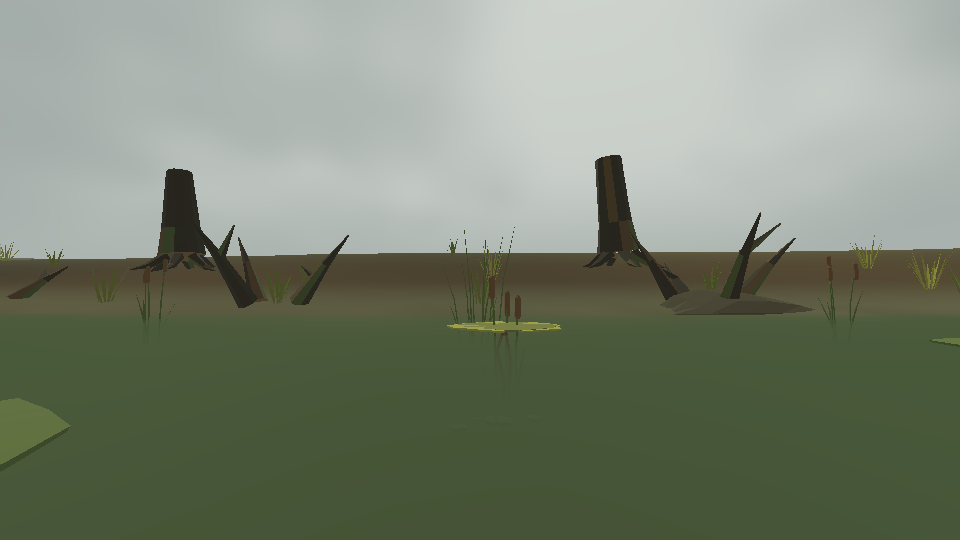
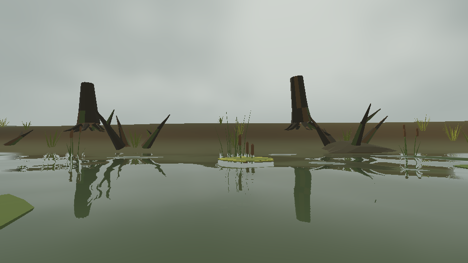

# R3 — pinned build and actual-Pond comparison

**Result: pinned build, four affected state checks and fifteen actual-Pond captures completed. P12/V32 remain NOT GREEN.** This extends the earlier [4.6.3 isolated shader diagnostic](../diagnostic/README.md). Owner-controlled play, motion stability, camera comfort and Radeon 880M performance remain unobserved.

## Actual Pond before and after

Both images use the same tracked seed-71 Pond, current sky, Overcast profile, camera, restored local inputs and fixed shader time. `legacy` selects the original water shader; it is not a complete pre-R3 atmosphere checkout.

**Original surface, current sky**



**Candidate surface, same view**



The candidate adds recognizable inverted stumps, roots and reeds. Its [sky-only control](actual-pond/captures/low_bank_sky_only.png) removes those reflected shapes. The [oblique bank](actual-pond/captures/oblique_bank_candidate.png) retains olive transmission and floating-pad detail. The [0.5 m fish](actual-pond/captures/fish_050cm_candidate.png) remains visible, while the [4 m fish](actual-pond/captures/fish_400cm_candidate.png) is strongly attenuated.

The open, overcast Pond produces a paler low-angle surface than the supplied dense-canopy references. These samples establish a reflection improvement. They do not establish reference-image parity or moving-camera stability, and they do not complete the continuous shallow→deep route review.

## Source and runtime

| Item | Observed value |
| --- | --- |
| Shader and managed-code source | `e93ecf5e6bc2d00d6738fce9766d98f17585a4ca` |
| Capture-time source change | Only the probe capability guard; [exact diff](actual-pond/probe-capability-fix.diff) and [source record](actual-pond/source-identity.json) |
| Godot | `4.7.2.stable.mono.official.ed1daf0bf` |
| .NET SDK | `10.0.403` |
| Renderer/device | Forward+, Vulkan, Mesa `llvmpipe (LLVM 19.1.7, 256 bits)` software device |
| Display | Virtual X11, actual viewport 960 × 540, vsync disabled, engine frame cap 0 |
| World | Tracked baked Pond `world-5e3b4fee759acbe3`, seed 71; zero generator invocations |
| Baked content hash | `d76eabbb5b6fff2f91418b49b2de92dd090541d609b46d0725ad9fc85cbda347` |
| Fish/scenery | Real Bluegill `FAF-FISH-006`; 1,101 FAF placements, 12 ambient actors |
| Capture schedule | Five poses × `legacy` / `candidate` / `sky_only`; 30 warmup frames and 30 measured intervals each |
| Frozen state | Surface/sky time 12 seconds; fish and camera transforms unchanged throughout each sample |
| Completion | Exit 0; 15 captures; empty failures; no engine/shader/script errors or warnings in the successful render log |

The exact official tool archive URLs and verified hashes are in [runtime-manifest.json](runtime-manifest.json). Tools were extracted into isolated scratch; project pins and system installations were unchanged. The successful [raw report](actual-pond/captures/comparison.json), [invocation](actual-pond/invocation.json), [runtime log](actual-pond/probe.log) and [analysis with file hashes](actual-pond/analysis.json) retain the observed conditions. Absolute paths inside raw reports/logs are historical execution paths; the evidence links here are relative and durable.

## Build and affected checks

| Executed check | Result | Evidence |
| --- | --- | --- |
| `./tools/dev doctor` | PASS: exact pinned engine and SDK selected | [Doctor log](logs/doctor.log) |
| `./tools/dev import` | PASS; repeated only to import restored dependencies | [Initial import](logs/import-wrapper.log), [texture import](logs/recovered-import-wrapper.log), [Fish3 import](logs/fish3-import-wrapper.log) |
| `./tools/dev build` | PASS: zero warnings, zero errors | [Build log](logs/build-wrapper.log) |
| `inspect-pond-atmosphere` | PASS: Pond profile, Ocean reset, Pond reload, fish unchanged and presets isolated | [Final log](logs/recovered-inspect-pond-atmosphere.log) |
| `inspect-pond-scenery` | PASS: 16/16 shore samples, 184 shore FAF placements; 31/32 sampled clearances with one recorded authored obstruction | [Final log](logs/recovered-inspect-pond-scenery.log) |
| `inspect-pond-camera-immersion` | PASS: five presets, orbit/zoom, camera above fish, pause/reentry and unchanged fish state | [Final log](logs/recovered-inspect-pond-camera-immersion.log) |
| `inspect-ocean-equal-input` | PASS: equal atmosphere-enabled/disabled physics route over 30 steps | [Final log](logs/fish3-inspect-ocean-equal-input.log) |

The three Pond checks ran on clean `e93ecf5`. The final Ocean check ran with only the probe guard modified, as recorded in [its source identity](fish3-check-source-identity.json); the probe is not part of that check's execution path. These are C#/state assertions. They do not substitute for normal-input clearance, native visuals or control comfort.

### Restored local dependencies and retained failures

The first four check attempts stopped on absent ignored Coast Sand/ambientCG texture dependencies. After those inputs were restored, the three Pond checks passed and the Ocean check identified a separate missing `Fish3.fbx`. Restoring that original model allowed the final Ocean check to pass. The [initial results](check-results.json), [intermediate results](recovered-check-results.json), [final Ocean results](fish3-recovered-results.json) and all corresponding logs are retained. These failures were missing-input problems; no world or material was altered to bypass them.

The [asset provenance record](asset-recovery/PROVENANCE.md) contains official sources, package versions/dates, sizes and installed-map hashes. Coast Sand maps and Fish3 match tracked historical SHA-256 values. The exact approved ambientCG IDs `Ground060`, `Gravel041` and `Rock063`, in 2K-JPG format, were restored from official versioned packages and copied without transformation. **Historical local-byte equality for ambientCG remains unverified** because the prior ignored inventory is unavailable. All three render modes share the same restored files. No texture, model archive, runtime package or generated import cache is committed in this evidence directory.

### Probe guard repair

The first native run stopped before scene load: the helper incorrectly expected `OS.has_feature("mono")`. The [failed report](probe-guard-failure/comparison.json) and [log](probe-guard-failure/probe.log) remain here. Queries of the [pinned Mono engine](probe-guard-failure/pinned-mono-capability.log) and [standard engine](probe-guard-failure/standard-capability.log) showed that `ClassDB.class_exists("CSharpScript")` correctly distinguishes their .NET capability. The helper now uses that capability check. The successful run retained all renderer, output, sample-count, pause and timeout guards.

## Underwater and timing limits

The actual-Pond [legacy](actual-pond/captures/underwater_legacy.png) and [candidate](actual-pond/captures/underwater_candidate.png) underwater images differ in 962 of 518,400 pixels, with maximum channel delta **1/255**. Candidate versus sky-only differs in four pixels, also at most 1/255. This is a near-identical sampled result, distinct from the earlier isolated fixture's exact same-sky pixel equality. Neither result establishes all transition angles or full-game equivalence.

The [full review](actual-pond/REVIEW.md) retains all fifteen median/p95 measurements. Low-bank median intervals were 125.32 ms legacy and 132.91 ms candidate; oblique-bank medians were 130.74 ms and 158.93 ms. These are short software-rendered, paused-view process/render intervals with scheduling and presentation included. They do not establish hardware headroom or incremental GPU cost on the owner's Radeon 880M. Draw counts match by pose, while shader work has increased.

## Reproduce and continue

Use the [R3 native handoff](../../../../manual/R3-surface-reflections-native.txt) on the configured Fish desktop after preserving local work:

```bash
./tools/dev review-pond-reflections
```

The wrapper imports/builds once and defaults to 90 measured intervals per capture. This retained run invoked the same helper directly with 30 intervals, the minimum supported sample count; its complete invocation is linked above. Reproduce on the owner's renderer and review both Pond lighting presets, low/high-effort swimming, orbit/zoom, air/water crossings, pause/refocus, world return and the outstanding routes. The capture completion marker remains `visual_status=NOT_JUDGED`; the owner's actual judgment is still required for acceptance.
